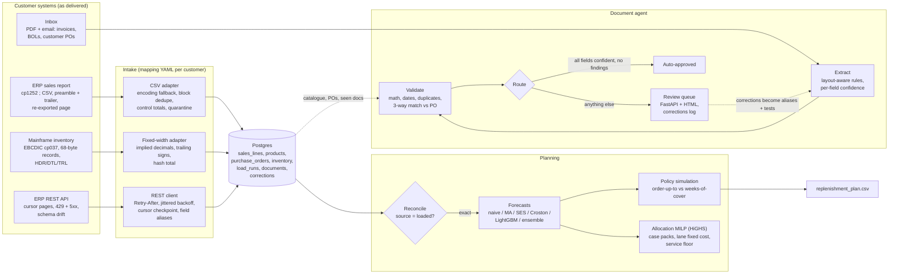

# FDE supply-chain platform

[](https://github.com/Samarateja0118/fde-supply-chain-platform/actions/workflows/ci.yml)

A forward-deployed-engineering project built as if for one customer, a (fictional) homewares
distributor called Harbor & Pine. It has the three things such a deployment usually needs:

1. **Document agent.** Pulls structured data out of messy supplier invoices, carrier bills of lading
   and customer purchase orders (PDFs and pasted emails in English, German, French and Spanish,
   plus a Dutch carrier). It checks each one against ERP data with a three-way match, and sends anything
   uncertain or wrong to a human review queue.
2. **Demand planning.** Weekly SKU forecasts on the real UCI Online Retail transactions (541,909
   lines, 500 SKUs), a replenishment-policy simulation, and a MILP that allocates scarce DC stock
   across regions.
3. **Integration.** Adapters for the customer's legacy sources: a cp1252 semicolon CSV report
   export, an EBCDIC fixed-width mainframe extract, and a rate-limited REST API that renames
   fields partway through. There is also a [deployment runbook](docs/RUNBOOK.md) with a
   troubleshooting table. Every row of that table is reproduced by a fixture or a test.

There is no LLM in the loop. No model API key was available while this was built, so extraction
is rule-based and layout-aware (pdfplumber word positions plus a multilingual label vocabulary).
The `Extractor` protocol in `src/fde/docs/extract.py` is where an LLM or a vendor IDP service
would plug in; validation, routing and the review queue don't depend on which extractor runs.

**At a glance** (details in [Measured results](#measured-results)):

- On 4 held-out document layouts written after the extractor was frozen, it got only 25% of documents fully right but **auto-approved 0 of the wrong ones**; everything uncertain went to review. After one onboarding round: 95.8% exact, 70.3% straight-through, still 0 wrong auto-approvals.
- Forecasts on real UCI Online Retail data: LightGBM + SES ensemble WAPE 0.530, 8.6% better than a 4-week moving average.
- Legacy intake (cp1252 CSV, EBCDIC fixed-width, flaky REST API) reconciles exactly: row count, quantity and revenue match the source, and the weekly demand matrix is bit-identical to one built from the original file. Every row of the runbook's troubleshooting table is reproduced by a fixture or a test.

```bash
make demo          # Docker: Postgres + mock ERP (with faults) + full pipeline; then review UI on :8000/review
make local-demo    # no Docker: SQLite + in-process mock ERP, ~80 s on 4 vCPUs
make test          # 30 tests, ~8 s, no dataset download needed
```

## Architecture



## Measured results

Everything below was produced by `make local-demo` and `make benchmark` on a 4-vCPU cloud
container (Python 3.11). The JSON is in [`results/`](results/). The Docker Compose run on Postgres
with the mock ERP over HTTP gave the same intake, reconciliation, forecast and allocation numbers.

### Document agent

400 generated documents per column, seed 4. There are 7 development layouts, written alongside the
extractor, and 4 held-out layouts. The held-out layouts were written **after** the extractor was
frozen at commit `ed00b69` and were never used to tune it. They add Spanish, right-aligned numeric
columns, hyphenated and lower-case SKUs, a simulated scanned PDF with OCR character confusions,
US month-first dates, and labels outside the dev vocabulary. About 30% of documents carry an
injected business problem: price variance, unknown PO, over-shipment, totals that don't add up,
due date before issue date, a duplicate invoice, a wrong carton count, an unknown SKU, or a
quantity that isn't a case-pack multiple.

| | dev layouts | held-out, frozen extractor | held-out, after 1 onboarding round |
|---|---|---|---|
| Document exact match (every field and line right) | 100% | 25.0% | 95.8% |
| Header field accuracy | 100% | 89.4% | 99.9% |
| Line-item F1 | 1.000 | 0.748 | 0.993 |
| Injected issues caught | 106/106 | 98/108 | 108/108 |
| Straight-through (auto-approved) | 73.3% | 17.8% | 70.3% |
| **Auto-approved documents with any error** | **0/293** | **0/71** | **0/281** |
| Clean documents sent to review anyway | 1/294 | 221/292 | 11/292 |
| Time per document | 33 ms | 37 ms | 35 ms |

The frozen-extractor column matters most. On layouts it had never seen, the extractor got only a
quarter of the documents fully right, but it auto-approved none of the wrong ones. Missing labels,
ambiguous dates and incomplete lines all lowered confidence and sent those documents to review.
The onboarding round was what a deployment engineer does after the first review batch. It added
about a dozen label aliases ("Tax Point", "P.O. Number", "Albarán nº"), made label matching
tolerant of OCR confusions ("T0tal"), gave each table column the band up to the next header so
right-aligned numbers land in the right column, and added one safety rule: a line missing a
column the table promises can never be auto-approved. That rule came from a bug found during
onboarding. Before it, 11 documents with a missing unit price were auto-approved, because the
price checks were skipped when there was no price. The fixes were tuned on held-out seeds 2 and 3
and then measured on fresh seed-4 documents, so the right-hand column is "known layouts, new
documents". It is not an unseen-layout number. The remaining errors are all in the simulated scan
(83% exact), and all of them went to review.

Per-sender date profiles are learned from unambiguous dates such as 25/03/2026. Once a sender has
one, "05/03/2026" from that sender doesn't need a reviewer. This cut clean dev documents sent to
review from 50/196 to 2/196 (dev set, seed 1, 280 documents).

### Forecasting (UCI Online Retail, 500 SKUs, weekly)

The data was cleaned with real rules. Fee codes were dropped (POST, DOT, AMAZONFEE...), and 2,953
cancellations were matched one-for-one to the order lines they cancel, which removes the 80,995-
and 74,215-unit orders that were cancelled minutes after they were placed. Forecasts used rolling
origins with 13 calibration weeks (Jun–Aug 2011) and 13 evaluation weeks (4 Sep to 27 Nov 2011).
Only evaluation weeks are scored.

| Model | WAPE h=1 | WAPE h=2 | Bias h=1 | MASE h=1 |
|---|---|---|---|---|
| Naive (last week) | 0.692 | 0.696 | −3.9% | 1.08 |
| Moving average 4w | 0.580 | 0.595 | −8.5% | 0.96 |
| Moving average 8w | 0.565 | 0.584 | −13.2% | 0.89 |
| Simple exp. smoothing | 0.545 | 0.564 | −12.7% | 0.86 |
| Croston (SBA) | 0.584 | 0.599 | −24.0% | 0.88 |
| LightGBM global (L1, lag/rolling features) | 0.535 | 0.551 | −22.2% | 0.86 |
| **LightGBM + SES ensemble** | **0.530** | **0.549** | −17.4% | **0.84** |

The ensemble is 8.6% better than the 4-week average on WAPE, which is a real but modest gain.
Every model under-forecasts, because the evaluation window is the Q4 ramp and the data has only one
prior year. That makes seasonality unlearnable, so calendar features are deliberately left out.

### Replenishment policy (simulated on the evaluation weeks, backorders, 1-week lead time)

Average inventory value (£) needed to reach a fill rate. These are frontier points, interpolated
over a sweep of the policy parameter:

| Policy | 80% fill | 85% fill | 90% fill |
|---|---|---|---|
| Textbook order-up-to, `F + z·RMSE`, MA4 forecast | 214,681 | 290,796 | 424,780 |
| Textbook order-up-to, ensemble forecast | 206,441 | 281,269 | 403,238 |
| Weeks of cover on MA4 (the customer's current rule) | 195,719 | 253,114 | 363,408 |
| **Weeks of cover on the ensemble forecast** | **169,142** | **226,202** | **327,236** |

When the parameter is picked on the calibration weeks and then scored on evaluation, which is what
you could actually deploy:

| Policy (target) | Parameter | Achieved fill | Avg inventory £ |
|---|---|---|---|
| Order-up-to MA4 (90%) | z = 1.50 | 83.3% | 260,828 |
| Order-up-to ensemble (90%) | z = 1.75 | 82.5% | 239,268 |
| Cover MA4 (90%) | 4.5 weeks | 90.6% | 383,085 |
| Cover ensemble (90%) | 5.0 weeks | 91.1% | 362,712 |

I expected the textbook policy to win, and it lost. Its buffer is a fixed number of units sized on
summer errors, so it misses its fill target by 7 to 8 points in peak season. Weeks of cover scales
with demand, hits the target, and with the better forecast holds 11% less inventory than the
customer's own rule at 85% fill (5% less at the deployable 90% setting). The runbook's
recommendation follows from that: keep their rule and feed it the better forecast. Three other
variants were tried and were worse: bias-corrected safety stock, CV-scaled safety stock, and
ABC-differentiated z.

### Allocation (next week's forecast for the top 60 SKUs, 3 DCs, 9 regions)

Stock is set to 85% of demand on purpose. Case packs are each SKU's most common order quantity
in the data. DCs, distances and costs are made up and labelled as such in `inventory/scenario.py`.

| Method | Total cost | Lanes | Fill | Worst region fill | Solve time |
|---|---|---|---|---|---|
| Greedy nearest-DC (today's process) | 22,854 | 11 | 81.9% | **0%** | 2 ms |
| MILP, no service floor | 13,296 | 3 | 78.3% | 0% | 0.18 s |
| MILP, 60% floor per region | 21,177 | 11 | 78.5% | 60% | 0.87 s |
| **MILP, 75% floor per region** | **21,687** | 11 | 77.8% | **75%** | 2.6 s |

The unconstrained optimum "saves" 42% by abandoning small regions whose lost margin is below a
truck's fixed cost. That is a correct answer to the wrong question, so the service floor is a
parameter. With a 75% floor the MILP is 5% cheaper than greedy and no region is starved. Greedy
left one region with nothing.

### Intake and reconciliation

- 13 monthly CSV exports with 541,909 lines are loaded. One re-exported page of 400 rows is
  removed by **block** dedupe. Row-level dedupe would have been wrong, because the source has
  genuine identical lines. Every file's trailer count reconciles.
- After intake, row count, quantity sum (5,176,450) and revenue (£9,747,747.93) equal the source
  exactly. The weekly demand matrix built from loaded data is **bit-identical** to the one built
  from the original file, and planning refuses to run if it isn't.
- REST: 400 products and 88 purchase orders came through 15% 429s and 10% 5xx (seeded) and a
  mid-stream rename (`unit_cost` → `unitCost`), with every record loaded and the drift reported.
  A crash mid-pagination resumes from the checkpointed cursor (tested).
- Re-running intake is a no-op, keyed by file SHA-256. Re-delivering a document returns the
  original record instead of processing it twice.

## Honest limits

- **The documents are synthetic.** They are generated from the real catalogue, but layouts, noise
  and injected issues are mine. Real inbound documents are messier: photographed pages, stamps,
  handwriting, multi-page tables. Without an OCR engine in this environment, "scanned" means a
  text-layer PDF with OCR-style character swaps, not real image OCR.
- The held-out layouts were written by the same author as the extractor, later in the same build,
  not by someone independent. The frozen-extractor column is the honest
  generalisation number. The post-onboarding column is a known-layouts number.
- Rule-based extraction needs per-sender onboarding. That is cheap for 10 senders and expensive
  for 1,000. At that scale an LLM or IDP extractor would replace `RuleBasedExtractor`, and the
  validation and routing layer would stay.
- The forecasting data covers one year, so there is no seasonality to learn, and the evaluation
  window is one peak season. Results would differ in a flat quarter.
- The inventory simulation has a fixed 1-week lead time, no supplier minimums, no capacity, and
  no lost sales. The allocation network (DCs, distances, costs, stock) is invented.
- The review UI is a functional server-rendered page with no authentication. It isn't for
  production as is.
- Docker image builds were verified in a sandbox that blocks `apt`. There the `libgomp1` package
  was supplied from the host instead of `apt-get`, and the committed Dockerfile uses `apt-get`.
  CI builds the committed Dockerfile.

## What I'd do at scale

- **Extraction:** put an LLM or IDP extractor behind the same `Extractor` protocol, and keep
  the rule-based one as a cheap first pass and as a cross-check (route to review when they
  disagree). Use the corrections table as the labelled set for evaluating any new extractor
  before switching.
- **Auto-approval as a per-sender credential:** enable it only after N shadow documents with zero
  corrections. Sample 2% of auto-approved documents for audit, and alert on the corrections rate
  per sender.
- **Intake:** land raw files in object storage first, since it's immutable and replayable, then
  load. Move the mapping YAML into a reviewed config repo per customer, with a contract test per
  source that runs against each new sample file. Add a schema registry for the API so drift
  becomes a page, not a note.
- **Planning:** hierarchical forecasts (SKU, category, total) with reconciliation, more history
  for seasonality, lead-time distributions from receipts instead of a constant, and policy
  parameters re-tuned on a rolling window before each peak. Allocation would run per day with
  real lane rates and DC capacities, warm-started from the previous solution.
- **Operations:** queue workers for documents, Postgres partitioning for sales lines, OpenTelemetry
  traces per document, and an SLO on review-queue age rather than on throughput.

## Repository layout

```
src/fde/
  intake/      exports.py (makes the legacy files), adapters.py, run.py, mappings/harbor_pine.yaml
  mock_erp/    server.py: ERP API stand-in with 429/5xx/schema-drift faults
  docs/        generator.py, styles.py, holdout_styles.py, render.py   (synthetic inbox + truth)
               extract.py, normalize.py, validate.py, service.py         (the agent)
               evaluate.py, benchmark.py                                (scoring)
  forecast/    prepare.py, models.py, backtest.py
  inventory/   policy.py, allocate.py, scenario.py
  api/app.py   review queue API + HTML
  pipeline.py  end-to-end demo;  cli.py: `fde demo | prepare | docs-benchmark | serve | fetch-data`
docs/RUNBOOK.md   customer deployment runbook
results/          measured outputs quoted above
```

Data: UCI Online Retail (Chen, Sain & Guo, 2012), fetched from a public GitHub mirror and checked
against its SHA-256 by `fde fetch-data`.
